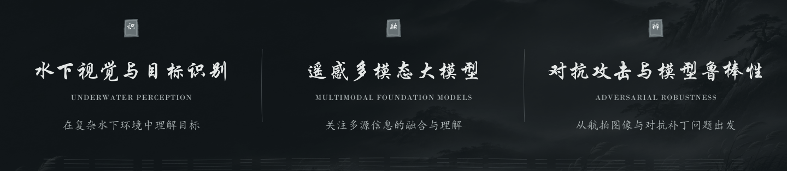
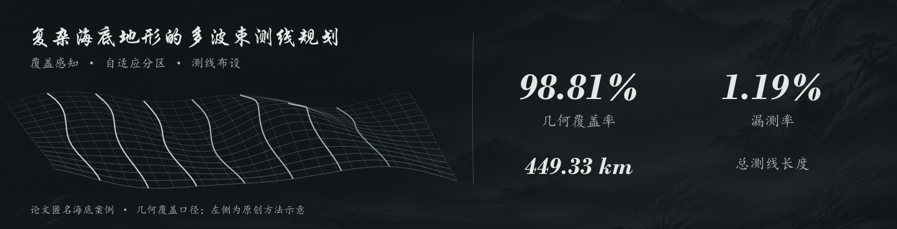

<picture>
  <source media="(max-width: 600px) and (prefers-reduced-motion: reduce)" srcset="assets/hero-mobile-static.svg">
  <source media="(max-width: 600px)" srcset="assets/hero-mobile.svg">
  <source media="(prefers-reduced-motion: reduce)" srcset="assets/hero-static.svg">
  
</picture>

  <a href="#关于我-about">关于我</a> ·
  <a href="#研究主线-research">研究主线</a> ·
  <a href="#代表工作-selected-work">代表工作</a> ·
  <a href="#竞赛与荣誉-honors">竞赛荣誉</a> ·
  <a href="#研究之外-offline">研究之外</a>

## 关于我 About

你好，我是**田承龙**，也可以叫我 **E7ian**。

目前就读于**曲阜师范大学网络空间安全学院，软件工程专业**，已保研至**西安电子科技大学电子工程学院，电子科学与技术专业硕士**，预计 **2027 年 9 月入学**。

我从多波束测深的地形建模与测线优化开始接触科研，也做过低光照稀疏视角的三维重建。接下来，希望把研究重点放在**水下视觉与目标识别、遥感多模态大模型、对抗攻击与模型鲁棒性**。

  

Incoming M.Sc. student at Xidian University · Software Engineering undergraduate at Qufu Normal University.

## 研究主线 Research

<picture>
  <source media="(max-width: 600px)" srcset="assets/research-mobile.svg">
  
</picture>

- **水下视觉与目标识别**：研究生阶段希望深入的方向。目前通过 [UTDR](https://github.com/teloon0805/UTDR) 记录机器学习、图像识别与检测的学习过程。
- **遥感多模态大模型**：关注遥感场景中的多源信息融合与理解，作为后续希望探索的研究方向。
- **对抗攻击与模型鲁棒性**：毕业设计围绕航拍图像的对抗补丁展开，正在学习相关方法并整理研究方案。

具身智能和 Agent 是我感兴趣、尚待深入的方向；也曾接触联邦学习与区块链相关课题。

## 代表工作 Selected Work

### 01 / 多波束测深：从复杂地形到测线规划

<a href="https://doi.org/10.1016/j.oceaneng.2026.129024">
  <picture>
    <source media="(max-width: 600px)" srcset="assets/multibeam-mobile.svg">
  
  </picture>
</a>

主持省级大学生创新训练项目 **《基于智能分区与优化算法的多波束测深系统测线布设研究》**。围绕复杂海底地形下的漏测与重复覆盖问题，参与覆盖次数矩阵、地形特征、自适应分区与测线规划方法的研究。

在论文的匿名真实海底案例、同一细网格几何覆盖评价口径下，方案将覆盖率从 **83.59% 提升至 98.81%**，漏测率从 **16.41% 降至 1.19%**。这些数字对应论文中的具体案例与设置。

**论文｜Ocean Engineering · SCI Q1 · 2026 · 已在线发表 · 共同作者** 
*Coverage-Aware Adaptive Partitioning for MBES Bathymetric Survey-Line Planning over Complex Seabed Terrain* 
[论文 / DOI](https://doi.org/10.1016/j.oceaneng.2026.129024) · [限时免费阅读，至 2026-12-10](https://authors.elsevier.com/c/1n~CS6nh7GLf8)

**国家发明专利｜已授权** 
《一种多波束测线布设优化方法、系统、设备和存储介质》 
专利号：**ZL 2025 1 0272094.6** · 授权公告号：**CN119783551B** · 授权日：2025-05-16

### 02 / CG-DropGS：低光照下的稀疏视角三维重建

**论文第一作者 · ICONIP 2026 · CCF C 类 · 已录用**

*Regularizing Low-Light Sparse-View 3D Gaussian Splatting via Contribution-Guided Dropout*

针对低光照与稀疏视角共同造成的重建约束不足，研究高斯基元的渲染贡献，提出贡献引导的临时 Dropout，并结合阶段自适应调度与有界不透明度补偿，改善新视角合成的结构稳定性。扰动用于训练阶段，推理使用完整的高斯表示。

Chenglong Tian, Jingwen Lu, Hui Song · 论文署名沿用 Chenglong Tian；个人主页使用 E7ian。代码暂未公开。

### 03 / 正在积累的学习与研究记录

| 项目 | 关注的问题 | 当前阶段 |
| :--- | :--- | :--- |
| [**UTDR**](https://github.com/teloon0805/UTDR) | 水下目标识别与检测；从机器学习基础走向图像理解 | 理论学习、练习与日志积累 |
| [**航拍图像对抗攻击研究**](https://github.com/teloon0805/Research-on-Adversarial-Attacks-for-Aerial-Images) | 对抗补丁如何影响检测器，怎样评价模型鲁棒性 | 基础学习与研究准备；公开仓库待补充 |

其他项目与创作经历

- **AIGC 科幻视听创作**：参与《冰封世纪》等作品，使用 ComfyUI、Stable Diffusion / FLUX、Runway、可灵与 GPT-SoVITS，尝试人物一致性、分镜、视频与语音生成的衔接。
- **数学建模与优化**：参与建模竞赛与项目实践，积累问题拆解、模型设计、数据处理和可视化经验。
- **软件著作权**：参与《人工智能大模型优化系统 V1.0》，登记号 **2026SR0183737**。

## 竞赛与荣誉 Honors

| 年份 | 比赛 / 方向 | 奖项 |
| :--- | :--- | :--- |
| 2025 | 第七届国际青年人工智能大赛 · 智慧工厂任务挑战赛 | **全国二等奖** |
| 2025 | 第十六届蓝桥杯 · AIGC 微短剧创意设计（高校组）·《冰封世纪》 | **全国三等奖** |
| 2025 | 全国大学生数学建模竞赛 | **山东赛区二等奖** |
| 2025 | 第十六届蓝桥杯 · 项目实战赛 · 智能体开发 | **山东赛区二等奖** |
| 2026 | 第十九届中国大学生计算机设计大赛 ·《古桥三章·线韵千年》 | **山东省级赛二等奖** |

更多竞赛与校园荣誉

| 年份 | 比赛 / 方向 | 奖项 |
| :--- | :--- | :--- |
| 2025 | 第十六届蓝桥杯 · Python 程序设计大学 B 组 | 山东赛区三等奖 |
| 2025 | 第七届全球校园人工智能算法精英大赛 | 省级三等奖 |
| 2025 | 第十六届蓝桥杯 · AIGC 微短剧创意设计 ·《符链古今》 | 省赛三等奖 |
| 2025 | 第十六届蓝桥杯 · 数字科技创新赛 ·《游无界、迹有痕》 | 全国选拔赛三等奖 |

山东省政府奖学金、国家励志奖学金、学校百优大学生、五好学生标兵等。

也曾参与中国国际孔子文化节志愿服务、CS2026 网络空间安全研讨会会务志愿工作。

## 工具与学习方式 Building & Learning

我主要借助 **Python 与 AI 编程工具**实现想法，目前也在持续补机器学习理论、Python 基础和关键代码的理解。喜欢先围绕一个具体问题做出东西，再回头检查它为什么有效、还有哪里没弄明白。

做过 AIGC 内容创作，也会用 **vibe coding** 尝试小工具和实验原型。C、C++、Java 主要来自课程学习。

## 研究之外 Offline

🎮 **燕云十六声 · 英雄联盟** 
🏓 **乒乓球 · 网球**

拿过新生杯男子乒乓球双打冠军，也在网球社团做过宣传工作。研究、创作、运动和游戏，都是我愿意花时间探索的事情。

欢迎通过 [**13774949997@163.com**](mailto:13774949997@163.com) 交流研究问题、学习记录，或好玩的创作想法。

